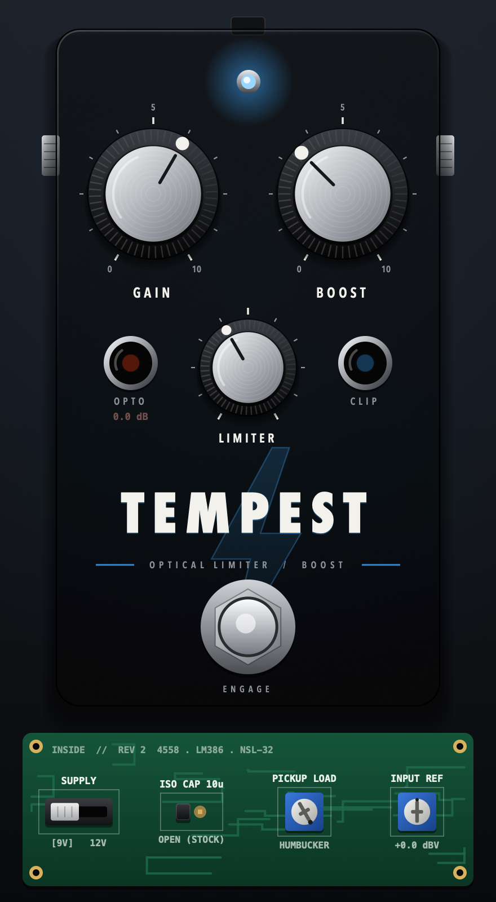

# Tempest

An optical limiter and boost plugin for macOS, modelled on the SoloDallas
Schaffer Replica Storm (version 2, 2019): the pedal built to recreate the
boost-and-squash that the Schaffer-Vega wireless put on Angus Young's
guitar. Built with JUCE 9 as a VST3, an AU and a standalone app.

It is named "Tempest" because Storm, Schaffer Replica and SoloDallas are
trademarks. It is a sibling of Sighs and Halfcock, and builds against
Sighs' JUCE checkout by default.



For why it sounds the way it does, with an interactive scope running the model, open [tempest-explained.html](tempest-explained.html) in a browser.

## Install locations

Building installs the plugins automatically:

- VST3: `~/Library/Audio/Plug-Ins/VST3/Tempest.vst3`
- AU: `~/Library/Audio/Plug-Ins/Components/Tempest.component`
- Standalone: `build/Tempest_artefacts/Release/Standalone/Tempest.app`

## Controls

On the pedal:

| Control | Range | What it does |
| --- | --- | --- |
| Gain | 0 to 10 | Input level into the op-amp stage and its optical limiter. Up high, the LM386 after it starts to clip. |
| Limiter | 0 to 10 | How hard the optical limiter works. At 0 it does almost nothing; at 10 it holds a 25 dB rise in input to about 10 dB. It does more with Gain up. |
| Boost | 0 to 10 | Output level. A plain volume pot after everything else, so it never changes the drive. |
| Engage | footswitch | True bypass. Off returns the input untouched. |

The **Opto** window glows with the LED inside the optical cell and reads out
the gain reduction. The **Clip** window flashes when the LM386 runs out of
headroom.

Inside the box (the green board):

| Control | Options | What it does |
| --- | --- | --- |
| Supply | 9 V / 12 V | The pedal takes either. 12 V gives the op-amp and LM386 about 3 dB more swing before they clip. |
| Iso Cap 10u | Open / Fitted | A smoothing capacitor across the LED. The board has a place for it, labelled "isolator threshold", but the traced unit left it out. Open (stock) lets the LED flicker at twice the note frequency, which adds a little grit to low notes with the limiter high. Fitted is smoother and a touch slower. |
| Pickup Load | None / Single Coil / Humbucker | The pedal's input is about 100k, which damps a passive pickup's resonant peak. A DI recorded through a 1M Hi-Z input doesn't have that, so this puts it back. None for active pickups or re-amped material. |
| Input Ref | -12 to +12 dBV | How many volts a full-scale sample stands for, which sets where in the circuit's range your DI sits. At 0 dBV, a humbucker DI that peaks around -6 dBFS is about right. |

**Starting points**

- Clean boost into an amp sim: Gain 4, Limiter 0, Boost to taste.
- Rhythm squash: Gain 7, Limiter 5, Boost 6.
- Lead sustain: Gain 10, Limiter 8, Boost 6.

The pedal is meant to hit an amp, so put Tempest before your amp sim. Its
output is hot: up to about 28 dB above the input with Gain and Boost full,
as on the pedal.

## How it is modelled

The circuit comes from Aion FX's trace of a 2019 Storm, published as the
"Gale" kit, which Aion says has "no changes except added power filtering".
PedalPCB's "Closed Circuit" is an independent board of the same circuit.

```
in -> 2k -> GAIN (100k lin, as a divider) -> IC1A (4558, non-inverting)
             IC1A gain = 1 + (15k || LDR) / 2k: 8.5x dark, about 1.1x lit
IC1A out -> IC1B (inverting, gain = LIMITER / 10k, 0 to 10)
IC1A out -> 1k -> [4x BAT42 bridge with the LED inside] <- IC1B out
             the LED lights the LDR in IC1A's own feedback loop
IC1A out -> 1u -> 2k -> 8.2k / 2k pad (about 0.16) -> 100n -> LM386 (gain 20)
LM386 out -> 10u -> 10R -> BOOST (1k lin, as a divider) -> out
```

Some details of that circuit matter to the sound:

- **The limiter is inside the gain stage.** The light-dependent resistor
  sits across IC1A's 15k feedback resistor, so lighting it lowers the gain
  of the stage itself. Gain reduction is capped at about 18 dB, the
  difference between 8.5x and 1.1x.
- **It is a feedback limiter.** The sidechain reads IC1A's output, so as it
  pulls the gain down it also pulls down its own drive. That gives the
  gentle, programme-dependent curve.
- **The bridge sees V1 x (1 + k).** IC1B inverts and amplifies, and the
  rectifier sits between the two op-amp outputs. Even at Limiter 0 the LED
  lights once IC1A's output passes about 2.2 V. That only happens with Gain
  high and a hot input, near IC1A's clipping point, and the engine does the
  same.
- **The LM386 clips first.** It sees IC1A's output times 3.2, so it
  saturates at about 1.1 V out of IC1A, well before the 4558 does. That
  makes it the "harmonic clipping" stage. Raising Limiter keeps IC1A's
  output back from it, which is why SoloDallas describe the limiter as
  protecting against clipping.
- **There is no tone stage.** Apart from coupling caps, the circuit is flat
  to beyond 20 kHz. The low-mid push and softened top end players hear come
  from the pickup loading, the limiter's dynamics and the LM386's harmonics.

The engine runs at 4x oversampling and works in volts:

- GAIN and BOOST are exact dividers, including the 1M bias resistor
  loading GAIN's wiper.
- IC1A is computed from the current through its ground leg, which makes it
  exact for a changing feedback resistance. Its 8 Hz ground-leg corner and
  the three coupling caps are all included.
- The sidechain runs every sample: IC1B with its own clipping, full-wave
  rectification, and the LED and Schottky knee. With the isolator cap
  fitted, the cap's node voltage is integrated as it charges through the 1k
  and discharges through the LED.
- The LDR's conductance follows the LED current as a power law, through two
  layers: a fast one, and a slow one that builds up under sustained light
  and leaves a tail. That tail is the "memory" CdS cells are known for.

### Measured from the engine

Run `tests/tempest_test.cpp` to reproduce these.

- **Maximum gain:** 28.3 dB, against 28.4 dB from the part values. The
  manual says "around 25 dB" and the brochure says 31 dB.
- **Low end:** -3.4 dB at 40 Hz, -0.6 dB at 100 Hz, matching the coupling
  caps to 0.01 dB. Flat to 20 kHz.
- **Pickup loading at the resonance:** humbucker about -11 dB around
  2.5 to 3 kHz; single coil about -13 dB around 4 kHz.

**Limiter, 220 Hz, Gain 10, Boost 10, output in dBV:**

| Input dBV | Limiter 0 | Limiter 5 | Limiter 10 |
| --- | --- | --- | --- |
| -40 | -11.8 | -11.8 | -11.8 |
| -30 | -2.0 | -2.0 | -6.5 (4.9 dB GR) |
| -20 | +6.3 (LM386 clipping) | +5.7 | -3.8 (12.2 dB GR) |
| -10 | +8.8 | +6.9 | +2.6 (15.2 dB GR) |

**Timing** (Limiter 10, a burst at -20 dBV):

- Attack: 90% in about 4 ms.
- Release: to 3 dB in about 180 ms, to 1 dB in about 720 ms.

Retailers describe the real pedal as "fast attack and medium-slow release".

### From a source

- **From the Aion FX / PedalPCB trace:** every resistor, capacitor and pot
  value and taper, the topology, the chips (RC4558, LM386N-1, NSL-32, BAT42),
  and the unfitted isolator cap.
- **From the NSL-32 datasheet:**
  - 160 ohm at 16 mA
  - more than 500k dark
  - 40 mA maximum
  - 55 ms rise; 80 ms decay to 100k
- **From the LM386 datasheet:** 50k input resistance; gain 20 with the
  gain pins open.
- **From the 2020 manual:**
  - the 9 to 12 V supply
  - Limiter fully anticlockwise is off
  - Gain drives both the limiter and the clipping

### Estimates, not from a source

- **Swing and clipping:** how far the 4558 and LM386 can swing at 9 V and
  12 V (±3.5 V and +3.3/-3.8 V at 9 V), and the shape of each clip. The
  LM386 is given a softer, slightly asymmetric curve.
- **LED and diodes:** a 1.7 V knee, 25 ohm above it, and 0.25 V per BAT42.
- **The LDR:**
  - The resistance curve slope (R proportional to I^-0.8) and the 10 mA
    current cap.
  - The two-layer time constants: fast 4 ms on and 16 ms off; slow 150 ms
    on and 400 ms off.
  - The split between the layers: 85 / 15.
  - The time constants were chosen to sit near the datasheet's decay and
    the retailers' "fast attack, medium-slow release". They were not
    measured on a pedal.
- **Pickup models:** 2.5 H / 6k / 600 pF and 4.4 H / 8.5k / 750 pF,
  including about 15 ft of cable.
- **The pot tapers' exact curves.** The A taper is 10% at half travel.

### Not modelled

- **Things in the marketing but not the trace:** the "EQ Expander", the
  compander (that was in the original Schaffer-Vega wireless and is in the
  big EX Tower, not this pedal), and the internal output trimmer one
  retailer mentions.
- **The 2026 Storm (top jacks).** Its "LM308-flavored" boost may be a
  different circuit.
- **Hiss.** The manual says it can't be avoided into high-gain amps; the
  plugin is silent.
- **Other hardware details:** battery sag, the 120 pF input filter (not
  fitted on the traced unit), part tolerances.
- **Polarity:** the circuit's output polarity isn't modelled, so switching
  Tempest in and out never flips the signal.

## Status

- The engine matches the circuit's gain and frequency response.
- The limiter's static curve, timing, supply headroom, isolator smoothing
  and pickup loading all behave as the circuit predicts.
- It stays finite and bounded under full-scale noise and square waves with
  every control jumping each block.
- **Host test:** a headless run of the processor at 44.1, 48 and 96 kHz,
  mono and stereo, with blocks of 32 to 1024 samples:
  - Latency is 61 samples from the oversampling filters, and the bypassed
    signal is kept aligned.
  - State saves and restores, bypass returns the input, and the editor
    renders.
- Not yet loaded in a real host.
- **AU validation fails.** `auval -v aufx Tmpt Ncox` fails with "didn't find
  the component", as it does for Sighs and Halfcock. None of the three show
  in `auval -a`, so the cause is this machine's AU registry, not this
  plugin. The VST3 is unaffected.
- The VST3 has not been run through a validator such as pluginval.
- **By ear:** into a Suhr Bella set almost clean, at the edge of breakup, it
  sounds very close to YouTube demos of the pedal. It has not been compared
  side by side with a real unit.

## Building

Requires Xcode and CMake. JUCE is not committed. The build uses, in order:

1. `-DJUCE_DIR=/path/to/JUCE` if given
2. a `JUCE/` directory in this project
3. `../univibe/JUCE`, the checkout Sighs uses

```sh
cmake -S . -B build -DCMAKE_BUILD_TYPE=Release
cmake --build build -j 10
```

## Tests

```sh
# DSP only, no JUCE: gain, response, limiter curve and timing, pickup
# loading, supply, bypass, stress. Pass a path to also render an audition clip.
clang++ -std=c++20 -O2 tests/tempest_test.cpp -o build/tempest_test
build/tempest_test build/tempest_demo.wav

# The JUCE processor, driven the way a host would. Run from the project root;
# it writes UI snapshots to build/editor.png and build/editor-lit.png.
cmake --build build --target TempestProcessorTest -j 10
build/TempestProcessorTest_artefacts/Release/TempestProcessorTest
```

The audition clip is about 43 seconds: a synthetic power-chord riff, played
dry and then through four settings. Each section is normalised to the same
peak so you hear the character, not the level jump. The test prints each
section's real level and crest factor.

## Layout

- `Source/TempestDSP.h`: the whole model, with no JUCE dependency. The
  part values are at the top.
- `Source/PluginProcessor.*`: parameters, oversampling, state.
- `Source/PluginEditor.*`: the UI.
- `tests/`: the two test programs above.

## Sources

- [Aion FX Gale documentation (traced schematic)](https://aionfx.com/app/files/docs/gale_documentation.pdf)
- [PedalPCB Closed Circuit documentation](https://docs.pedalpcb.com/project/ClosedCircuit.pdf)
- [Storm manual, rev 0.1 (version 1)](https://cdn.shopify.com/s/files/1/1584/0975/files/MANUAL_rev0-1.pdf)
- [Storm brochure, 2020](https://cdn.shopify.com/s/files/1/1584/0975/files/SD_Storm_Brochure_Final-2020-min.pdf)
- [SoloDallas EU product page](https://www.solodallas-europe.com/products/storm)
- [SoloDallas: Tower Power](https://solodallas.com/blogs/news/tower-power)
- [NSL-32 datasheet](https://mm.digikey.com/Volume0/opasdata/d220001/medias/docus/5337/NSL-32_Rev.A_Aug.19,2021.pdf)
- [Premier Guitar: Storm update with top jacks](https://www.premierguitar.com/news/solodallas-updates-schaffer-replica-storm-with-top-jacks)
- [Schaffer-Vega diversity system (Wikipedia)](https://en.wikipedia.org/wiki/Schaffer%E2%80%93Vega_diversity_system)
